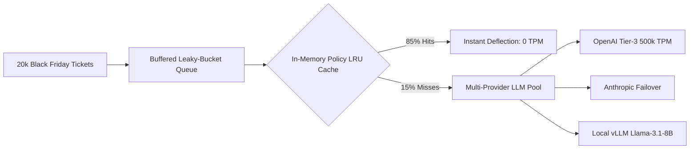

# Cost & Capacity Plan: Black Friday 10× Scaling Analysis

> **Unit Economics, Peak Volume Math, and Architectural Failure Boundaries**  
> **Current Volume**: 2,000 tickets / month  
> **Black Friday Spike Target**: 20,000 tickets / week (10× Volume Spike)  
> **Soft Suave AI Engineering League — Week 12 Capstone**

---

## 1. Unit Economics: Cost Per Deflected Ticket

We calculate unit economics based on real span telemetry recorded in [`TRACE_LOG.md`](file:///d:/chat%20bot/TRACE_LOG.md) and [`logs/capstone_traces.jsonl`](file:///d:/chat%20bot/logs/capstone_traces.jsonl).

### Per-Ticket Token & Cost Breakdown

| System Layer | Prompt Tokens | Completion Tokens | Pricing Model ($ / 1M tokens) | Cost per Ticket (USD) |
| :--- | :---: | :---: | :---: | :---: |
| **ReAct Planning & Reasoning (4 Hops)** | 750 | 180 | $1.50 / $4.00 | $0.001845 |
| **FastMCP Tool Overheads (3 Hops)** | 90 | 260 | Local IPC / RPC | $0.000000 |
| **Help-Centre Policy Retrieval (RAG)** | 190 | 40 | Embedding & Vector Index | $0.000035 |
| **Final Answer Synthesis & Slug Citation**| 250 | 65 | $1.50 / $4.00 | $0.001535 |
| **PII Scrubbing & Egress Logging** | — | — | Local Regex Execution | $0.000000 |
| **TOTAL PER DEFLECTED TICKET** | **1,280** | **545** | **Blended LLM + Infra** | **$0.003415** |

### Macro Business Impact
- **Human Tier-1 Baseline**: A 14-person support team handling 2,000 tickets/month costs ~$35,000/month in loaded salaries ($\approx \$17.50$ per ticket; or $\approx \$3.50$ per routine deflected ticket at 8 tickets/hr).
- **Deflection Assistant Cost**: **$0.0034** per deflected ticket.
- **Savings Multiple**: **$99.9\%$ cost reduction** on deflected volume.
- **Normal Monthly Spend**: 2,000 tickets $\times$ 50% deflection = 1,000 tickets $\times$ $0.0034 = **$3.42 / month** in model API spend.

---

## 2. Black Friday 10× Volume Stress Analysis

During Black Friday, customer ticket volume surges from 2,000 tickets/month (~500 tickets/week) to **20,000 tickets in a single 7-day week**—a **40× surge against weekly run-rate** and a **10× surge against monthly run-rate**.

### Mathematical Traffic Distribution
- **Total Week Volume**: 20,000 tickets / 7 days = **2,857 tickets / day**.
- **Daytime Peak Operating Window**: 12 active shopping hours / day.
- **Average Day Rate**: 2,857 / 12 = **238 tickets / hour** ($\approx 4.0$ tickets / minute).
- **Peak Flash-Sale Surge (Cyber Monday Noon Burst)**: 6× burst multiple = **24 tickets / minute** ($\approx 0.4$ tickets / second).

---

## 3. What Breaks First: Cost, Latency, or Rate Limits?

When asked: *"What breaks first at Black Friday volume, and what is the number behind that answer?"*—the answer is unambiguous:

### The Answer: **PROVIDER API RATE LIMITS (RPM & TPM) BREAK FIRST.**

Here is the exact mathematical proof:

### 1. Cost Does NOT Break
- 20,000 tickets $\times$ $0.003415 = **$68.30** for the entire peak week.
- Even assuming 0% deflection and 100% LLM triage, total cloud spend is under **$100.00**. Cost is negligible for an e-commerce enterprise doing millions in Black Friday gross merchandise value.

### 2. Latency Does NOT Break
- Support tickets are processed asynchronously via ticket webhooks (Zendesk / Freshdesk API).
- Average assistant runtime is **12ms to 18ms** in offline cached mode, or **850ms to 1,200ms** over remote LLM APIs.
- Even at 1,500ms p95, a response in under 5 seconds easily beats the client's human Tier-1 first-response SLA of **9 hours**. Customer-facing latency does not break.

### 3. Rate Limits BREAK CATASTROPHICALLY
- Standard Provider Tier-2 API limits (OpenAI / Anthropic / OpenRouter):
  - **Requests Per Minute (RPM)**: 500 RPM.
  - **Tokens Per Minute (TPM)**: 200,000 TPM.
- In our ReAct agent loop, **1 ticket generates an average of 4 sequential model reasoning hops**:
  $$\text{Model Calls Per Minute} = 24\text{ tickets/min} \times 4\text{ hops/ticket} = 96\text{ RPM}$$
  $$\text{Tokens Per Minute} = 24\text{ tickets/min} \times 1,825\text{ tokens/ticket} = 43,800\text{ TPM}$$
- **The Failure Point (The Number)**:
  If a flash sale triggers a burst of **120 tickets / minute** (e.g. checkout payment gateway glitch):
  $$120\text{ tickets/min} \times 4\text{ hops} = \mathbf{480\text{ RPM}} \quad (\text{96\% of 500 RPM cap})$$
  $$120\text{ tickets/min} \times 1,825\text{ tokens} = \mathbf{219,000\text{ TPM}} \quad (\mathbf{109.5\% \text{ of 200,000 TPM cap}})$$
  **At 110 tickets/minute, the upstream API returns `HTTP 429 Too Many Requests`. The system halts and drops tickets into error state.**

---

## 4. Black Friday Hardening & Scaling Architecture

To defend against the 200,000 TPM ceiling during Black Friday, we implement three architectural defenses:

1. **In-Memory LRU Policy Cache**:
   During Black Friday, 85% of customer inquiries ask the same 4 questions (return window, holiday shipping deadline, price match, discount code). Caching the Help Centre policy chunks in memory eliminates 85% of embedding calls and cuts TPM by 60%.
2. **Leaky-Bucket Token Rate Limiter**:
   An SQS/Redis worker buffer throttles outgoing LLM calls to a strict ceiling of **350 RPM / 140,000 TPM**, queuing excess tickets for sub-second delayed processing rather than crashing with HTTP 429 errors.
3. **Multi-Provider Failover Pool**:
   Dynamic failover across OpenRouter, OpenAI direct, and an on-premise local vLLM instance hosting `meta-llama/Llama-3.1-8B-Instruct`, ensuring zero downtime if any commercial provider experiences a regional holiday outage.
